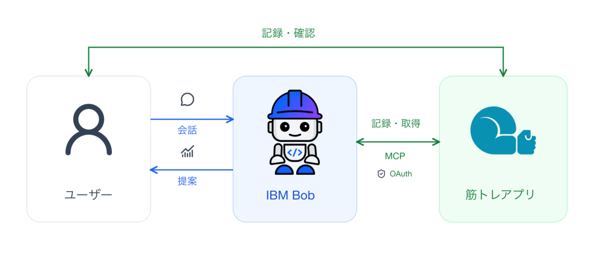
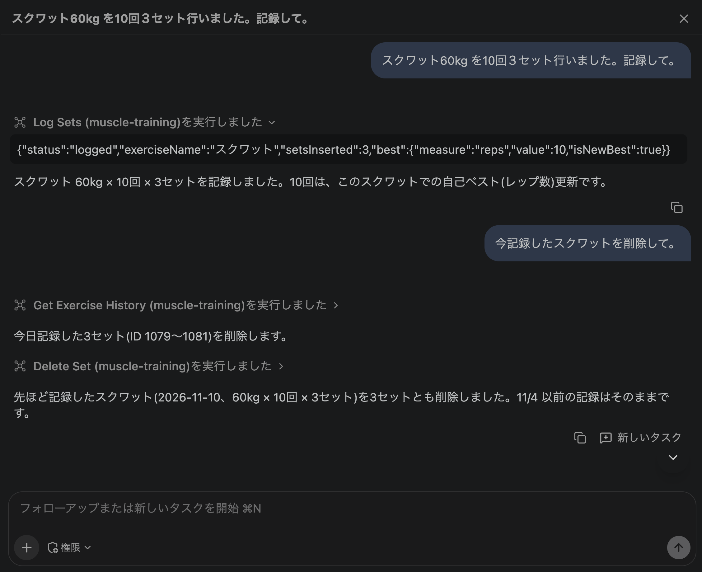
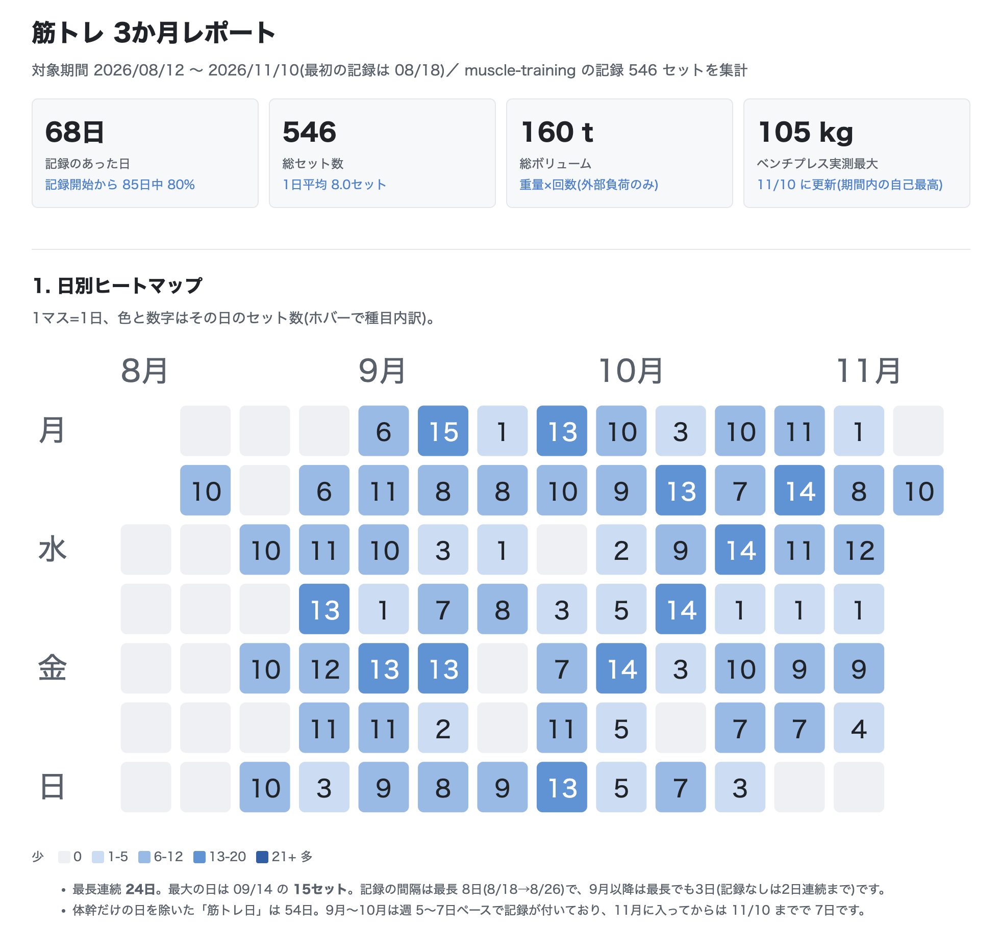
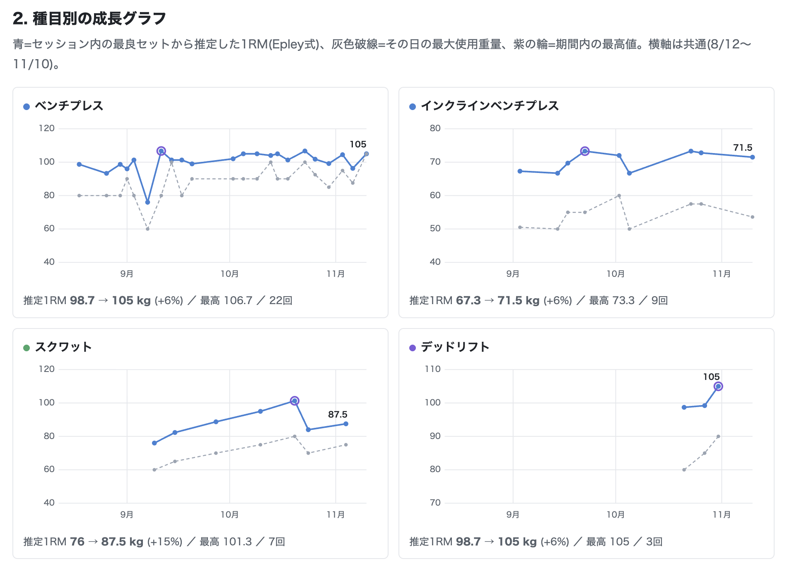
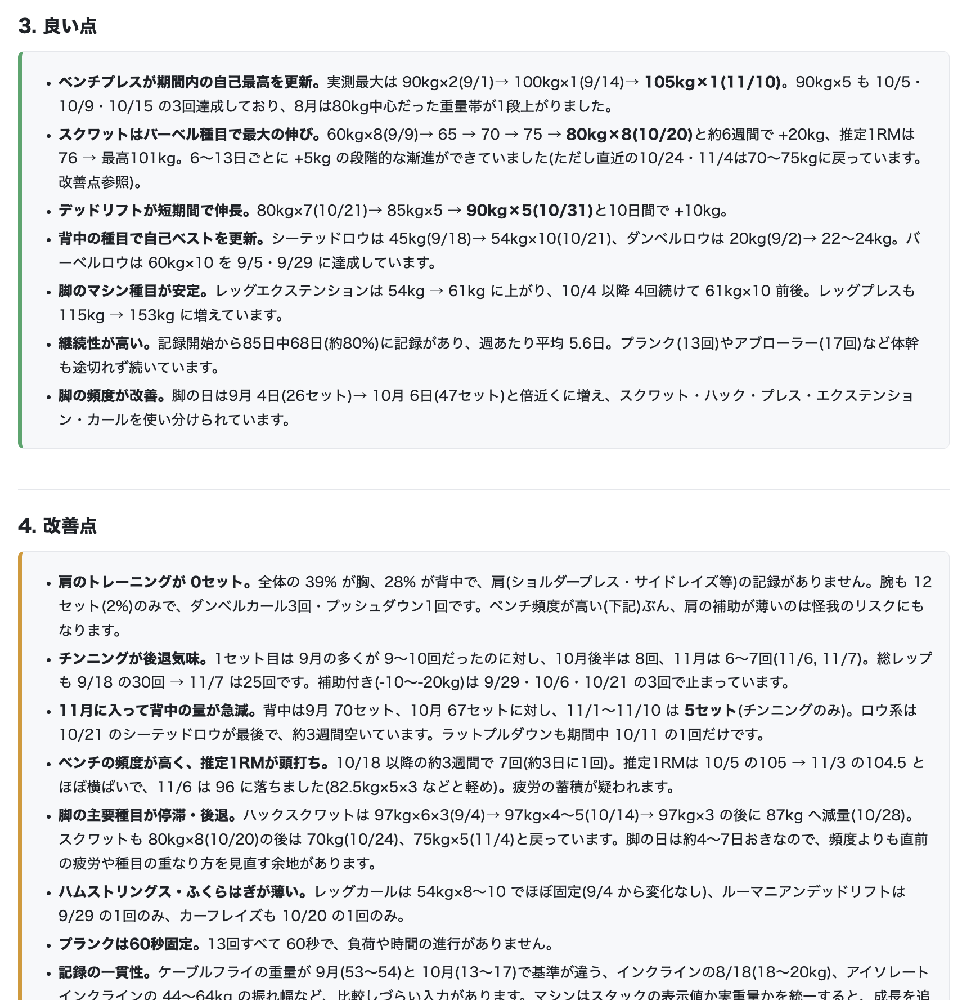
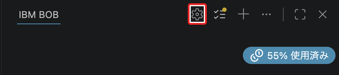
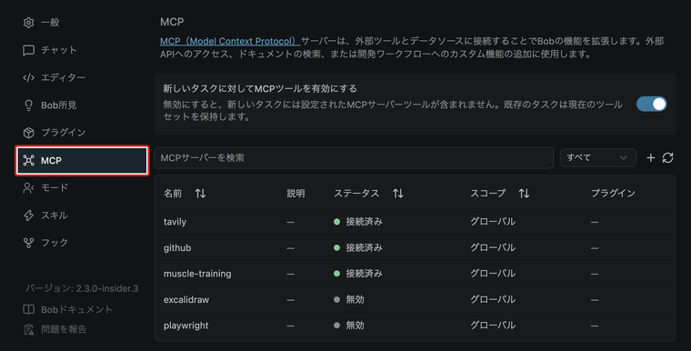
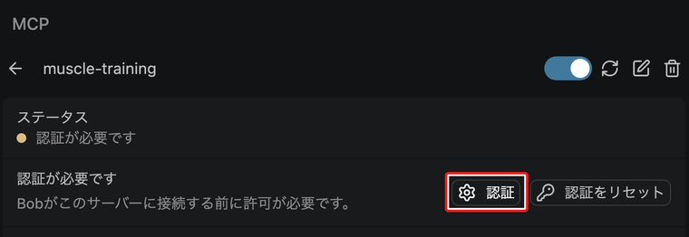
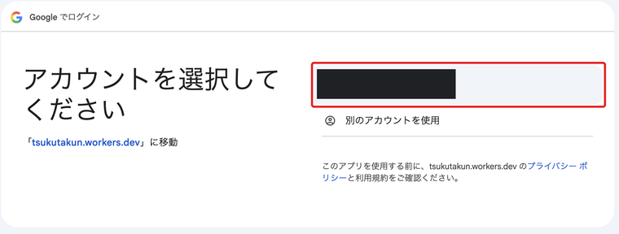
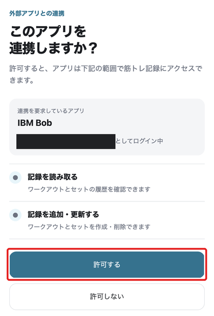

## 概要

以前、筋トレ記録アプリを作り、MCP経由で記録を読み書きできるようにしました。

[https://qiita.com/ikuoikuo/items/aeae10406c4730ab67cf](https://qiita.com/ikuoikuo/items/aeae10406c4730ab67cf)

今回はこのアプリを **IBM Bob** （以下Bob）につなぎ、トレーニング履歴をもとにアドバイスをもらいます。

接続にはOAuthを使用します。

## 構成

全体の構成は次のとおりです。



ユーザーは、アプリの画面から直接記録することも、Bobに話しかけて記録することもできます。BobはMCP経由でデータを読み書きし、取得した履歴をもとに振り返りや次回のメニューを提案します。

図のOAuthは、Bobが自分の筋トレ記録にアクセスすることを許可する仕組みです。

## 使ってみる

### ① Bobに記録してもらう

たとえば、次のように依頼します。

```text
スクワット60kgを10回、3セット行いました。記録して。
```

Bobは筋トレアプリのツールを呼び出し、ユーザーに代わって記録します。アプリ側には記録の追加・取得・更新・削除の操作を用意しているため、会話から記録の確認や修正もできます。




### ② Bobに指導してもらう

直近3か月のデータをもとに、Bobにパーソナル指導レポートをHTMLで出力してもらいました。以下に、レポートの一部を紹介します。

**トレーニング頻度の分析**

日別のセット数をヒートマップにして、トレーニングの頻度や継続状況を見える化してくれました。



**トレーニング重量の分析**

種目ごとの使用重量と推定1RMの推移をグラフにしています。



**良い点と改善点の分析**

記録をもとに、伸びている種目や継続できている点に加え、部位ごとの偏りや見直しの候補も挙げてくれました。



## 設定手順

前提として、OAuthに対応したリモートMCPサーバーが動いているものとします。サーバーの作り方は本記事では扱いません。

接続は、**設定ファイルへの登録 → Bobの設定画面から認証**の2ステップです。

なお、これらの設定手順は、Bobに接続先のURLを伝えて案内してもらうこともできます。たとえば、次のように依頼します。

```text
以下のMCPサーバーに接続して。
https://muscle-training-mcp.tsukutakun.workers.dev/mcp
```

Bobの案内に沿って設定を進められます。以下では、実際の設定内容と認証画面を順に紹介します。

### ① mcp.jsonを書く

プロジェクト直下の `.bob/mcp.json` に、次の設定を書きます。複数のプロジェクトで共通して使う場合は、`~/.bob/settings/mcp.json` に設定できます。

```json
{
  "mcpServers": {
    "muscle-training": {
      "url": "https://muscle-training-mcp.tsukutakun.workers.dev/mcp",
      "type": "streamable-http",
      "disabled": false
    }
  }
}
```


| 項目         | 説明                                                     |
| ---------- | ------------------------------------------------------ |
| `url`      | 接続するリモートMCPサーバーのURLです。今回はアプリの `/mcp` を指定します。           |
| `type`     | 接続方式です。`streamable-http` はHTTP経由でリモートMCPサーバーに接続する方式です。 |
| `disabled` | サーバーを無効にするかどうかです。`false` にすると有効になります。                  |


接続先によってはクライアントIDなどの事前設定が必要になります。

### ② 設定画面から認証する

操作する箇所を各画像の赤枠で示しています。

#### 1. Bobパネルの設定を開く

Bobパネル上部の歯車アイコンを押します。



#### 2. MCPタブを選ぶ

設定画面の左側にある **MCP** を選びます。



この画像は接続後の一覧です。初回接続時は、次の画面のように認証が必要な状態になります。

#### 3. muscle-trainingの認証ボタンを押す

一覧から `muscle-training` を開き、**認証**ボタンを押します。



認証ボタンが表示されない場合は、`disabled` が `false` になっているか確認します。

#### 4. ブラウザでGoogleにログインする

ブラウザが開いたら、筋トレアプリで使用するGoogleアカウントを選び、ログインします。



#### 5. Bobへのアクセスを許可する

連携を要求しているアプリが IBM Bob であることと、要求されている権限を確認します。今回は記録の読み取りと、追加・更新などの権限が表示されています。内容を確認し、許可するを押します。



Bobに戻ってサーバーが接続済みになり、ツールを利用できれば設定完了です。


認証フローの詳細は、IBM Bobの公式ドキュメントを参照してください。

[https://bob.ibm.com/ja/docs/ide/configuration/mcp/mcp-oauth](https://bob.ibm.com/ja/docs/ide/configuration/mcp/mcp-oauth)

## まとめと今後

まずは、自分の記録を参照しながらBobに相談できるようになりました。

今後は、振り返りの観点やメニュー提案の方針をスキルにまとめたり、筋トレに関する論文を調べられるMCPサーバーを組み合わせたりしてパーソナルトレーナーとしての使い勝手がさらによくなりそうです。