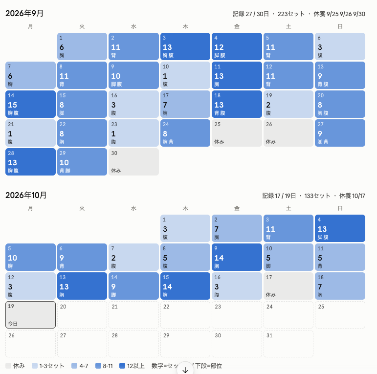
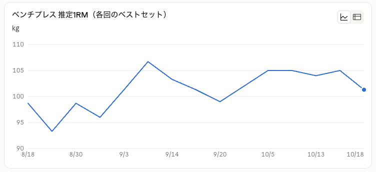
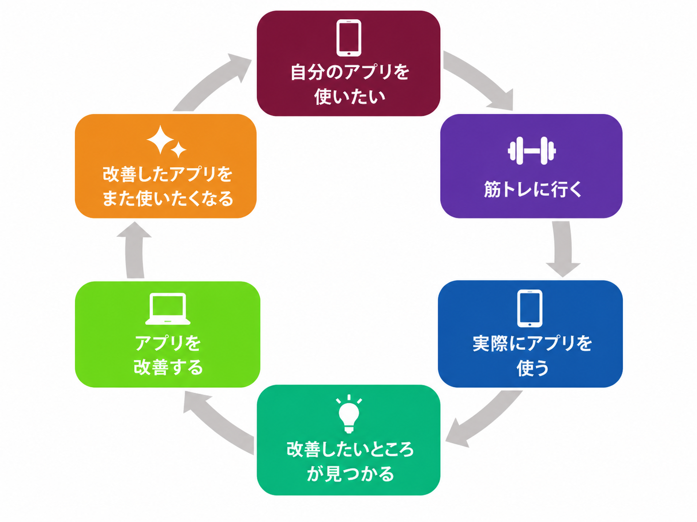

# 筋トレを続けたいなら、筋トレアプリを個人開発すればいいじゃない

## TL;DR

- 続けたいことがあるなら、それを支えるアプリを自分で作るのも一つの方法
- 自分のアプリを使いたくて筋トレに行き、筋トレをするからアプリも改善したくなる

「筋トレを続けたい。でも、なかなか継続できない。」「いろいろな筋トレ記録アプリを試しても、どうしても記録が続かない。」

そこで筋トレ記録アプリを作ってみたところ、筋トレの記録が続き、筋トレの頻度も向上しました。

この記事では、筋トレアプリの機能そのものよりも、**続けたいことのために自分専用のアプリを作ると、そのアプリへの愛着が継続のきっかけになった**という体験談をお話しします。

## 前回までのあらすじ

以前、日々の筋トレを記録するWebアプリを個人開発し、その内容を記事にしました。今回はその続きです。

[https://qiita.com/ikuoikuo/items/aeae10406c4730ab67cf](https://qiita.com/ikuoikuo/items/aeae10406c4730ab67cf)

このアプリの大きな特徴は、MCPに対応していることです。MCPクライアントから筋トレ記録を読み書きできるため、普段使っているAI（ClaudeやChatGPTなど）を自分のパーソナルトレーナーのように使えます。

たとえば、AIとの会話から次のようなことができます。

- その日のトレーニングを記録する
- 過去の記録を振り返る
- 最近の内容を踏まえて、次のメニューを相談する

筋トレアプリはこちらです。

[https://muscle-training-mcp.tsukutakun.workers.dev/](https://muscle-training-mcp.tsukutakun.workers.dev/)

## アプリを自作したことで起きた変化

### 作る前：続かない筋トレ記録

筋トレそのものは週に2回ほど行っていましたが、記録はなかなか続きませんでした。

トレーニングが終わったあとにアプリを開き、種目や重量、回数を入力する。やること自体は単純ですが、私は家計簿のように、こまめな入力や管理を続けることが苦手です。

記録できない日が増えると、過去との比較ができなくなります。成果が見えづらくなり、筋トレへのモチベーションも下がります。

### 作った後：記録が続き、筋トレの頻度も上がった

以下が、筋トレアプリを実際に使い始めてからの記録です。週2回ほどだった筋トレの頻度も上がり、最近はほぼ毎日なんらか筋トレは行っています（笑）。

記録も続くようになり、AIパーソナルトレーナー（Claude）からフィードバックをもらいながら、ベンチプレスやスクワッドなどの重量も着々と伸びていきました。

*日ごとのセット数とトレーニング部位を一覧できるカレンダー。GitHubの草を生やすのと同じ感覚でモチベーションが上がっています。*

*ベンチプレスの推定1RMの推移。記録がたまっていくと成長を振り返ることができます。*

## なぜこのような変化が起きたか

もちろん、このアプリは便利な機能があり、筋トレの記録がしやすいような工夫があります。しかしそれ以上に、**「自分で作ったアプリだから使いたい」**という感情が、筋トレの記録を継続でき、さらに筋トレの頻度まで上がった一番の理由だと考えています。

せっかく作った画面を触りたい。MCP経由でAIに過去のトレーニングを読ませたい。そのためには、まず記録する筋トレが必要です。

こうした気持ちを図にしてみると、次のような好循環が生まれていたことに気づきました。

アプリ開発が筋トレのきっかけになり、筋トレがアプリ開発のきっかけになる。どちらか一方を頑張って続けようとするよりも、ずっと自然に継続できています。

## 自分で使うアプリを自分で作るメリット

### 1. 自分が最初のユーザーだから、UXが育っていく

毎回の筋トレで自分のアプリを使うと、改善点がすぐに見つかります。

- 入力までの操作が多い
- トレーニング中に押しづらいボタンがある
- 前回の重量や回数をもっと見やすくしたい
- 同じ内容をもっと簡単に記録したい

こうした不満は、机の前で仕様を考えているだけでは気づきにくいものです。しかし、自分が実際の利用者なら、不便を感じたその日に直せます。

誰かの要望を想像して機能を増やすのではなく、昨日の自分が困ったことを今日直す。小さな改善でも次の筋トレですぐに効果を確かめられるので、開発の手応えも得やすくなりました。

たとえば改善した機能の例として、重量の調整ボタンを例に話します。

以前は、重量を入力するたびにボタンを何度も連打する必要がありました。20kgでウォームアップしたあと、60kgまで変更するだけでもかなり面倒です。

そこで、重量ボタンを長押しすると、早送りのように増減の速度が段階的に上がる機能を加えました。このように、実際に使って感じた小さな不便を、自分が使いやすい形へすぐに直せます。

### 2. データを自分で持てる

記録したデータをどう扱うかも自分で決められます。

筋トレの記録に限った話ではなく、昨今のAI時代、データが大変貴重な存在です。しかし、データが取り出せないケースやAPI連携できないケースなどはよくあります。自分のアプリなら、API連携や保存方式、エクスポート方法を自由にカスタマイズでき、必要なときにすぐデータを取り出せます。

### 3. 今は「自分専用アプリ」を作りやすい時代

少し前まで、自分だけが使うアプリを作るのは割に合わないと感じていました。実装して、デプロイして、運用するだけでも大変だったからです。

今は状況が変わっています。

AIに実装や調査を手伝ってもらえば、試作と改善を速いサイクルで回せます。Cloudflareのサービスも、個人利用程度の規模なら無料枠の範囲に収めやすく、小さく始められます。

さらに、自分が唯一のユーザーなら、万人向けの正解を探す必要はありません。

- 自分が迷わない画面にする
- 自分が使う種目だけに対応する
- 自分が使っているAIと連携する
- 自分の習慣が変わったら、その場で仕様も変える

市場調査も、多数のユーザーに向けた機能の説明も不要です。「自分に合うかどうか」だけを基準にできるので、個人開発と非常に相性がよいと感じています。

## まとめ

筋トレ記録アプリを作ったことで、継続して記録ができるようになり、さらには筋トレの頻度まで向上しました。

継続のためのアプリを自分で作ると、アプリへの愛着が、また使いたいという動機になり、そして、使うたびに改善点が見つかり、改善するとまた使いたくなるのかなと感じました。

これは筋トレに限らず、読書、勉強、家計管理、日記、料理など、続けたいのになかなか続かないことがあるなら、自分専用の小さなアプリを作ってみるのも一つの方法だと思います。今はAIやクラウドのおかげで、個人でも比較的簡単にアプリを作り、運用できる時代なので。
